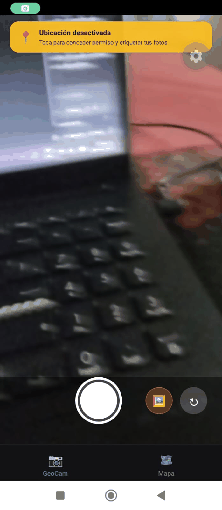

# GeoCam

Aplicación móvil Expo SDK 57 para capturar fotos geolocalizadas, guardarlas en SQLite y sincronizarlas con Supabase para verlas desde otros teléfonos.

## Bases de datos

```mermaid
flowchart LR
  A[Expo / React Native] -->|Drizzle ORM| L[(SQLite local geocam.db)]
  L -->|ownerId + syncedAt vacío| S[Sincronizar uno a uno]
  S -->|ArrayBuffer / Storage API| B[(Supabase Storage privado: geocam)]
  S -->|metadatos + client_id| R[(PostgreSQL: public.photos)]
  R -->|RLS por auth.uid()| A
  B -->|URL firmada temporal| A
  R -. Realtime .-> A
```

SQLite guarda el archivo local y sus metadatos. PostgreSQL guarda metadatos remotos y una ruta única al archivo; Storage conserva los bytes bajo `<auth.uid()>/<client_id>.jpg`. La columna local `owner_id` y todos los repositorios aíslan los datos del usuario activo. La migración `0002_owner_sync.sql` agrega propietario e identidad de sincronización; filas antiguas sin propietario se reclaman a la primera sesión iniciada en ese dispositivo.

### SQL local (Drizzle / SQLite)

Las migraciones completas y ejecutables están versionadas en [`drizzle/`](./drizzle/). El esquema resultante:

```sql
CREATE TABLE albums (
  id TEXT PRIMARY KEY NOT NULL,
  name TEXT NOT NULL,
  created_at INTEGER NOT NULL,
  owner_id TEXT
);
CREATE UNIQUE INDEX albums_owner_name_unique ON albums(owner_id, name);

CREATE TABLE photos (
  id TEXT PRIMARY KEY NOT NULL,
  uri TEXT NOT NULL,
  source TEXT NOT NULL CHECK (source IN ('camera', 'gallery')),
  latitude REAL,
  longitude REAL,
  accuracy REAL,
  coords_timestamp INTEGER,
  created_at INTEGER NOT NULL,
  album_id TEXT REFERENCES albums(id) ON DELETE SET NULL,
  note TEXT,
  favorite INTEGER NOT NULL DEFAULT 0,
  owner_id TEXT,
  client_id TEXT NOT NULL,
  updated_at INTEGER NOT NULL,
  remote_path TEXT,
  synced_at INTEGER
);
CREATE UNIQUE INDEX photos_client_id_unique ON photos(client_id);
```

SQLite no aplica RLS; el aislamiento está en cada consulta de `db/repositories/`, que siempre incluye el ID de sesión. Este SQL PostgreSQL completo también está versionado en [`supabase/schema.sql`](./supabase/schema.sql); aplícalo en el SQL Editor del proyecto Supabase antes de iniciar la app.

### SQL remoto (Supabase PostgreSQL y Storage)

```sql
create table if not exists public.photos (
  id bigint generated always as identity primary key,
  user_id uuid not null default auth.uid() references auth.users(id) on delete cascade,
  client_id text not null unique,
  storage_path text not null unique,
  latitude double precision,
  longitude double precision,
  note text,
  favorite boolean not null default false,
  source text not null check (source in ('camera', 'gallery')),
  taken_at timestamptz not null,
  updated_at timestamptz not null,
  created_at timestamptz not null default now()
);

alter table public.photos enable row level security;
create policy "photos_select_own" on public.photos for select to authenticated using ((select auth.uid()) = user_id);
create policy "photos_insert_own" on public.photos for insert to authenticated with check ((select auth.uid()) = user_id);
create policy "photos_update_own" on public.photos for update to authenticated using ((select auth.uid()) = user_id) with check ((select auth.uid()) = user_id);
create policy "photos_delete_own" on public.photos for delete to authenticated using ((select auth.uid()) = user_id);

insert into storage.buckets (id, name, public) values ('geocam', 'geocam', false)
on conflict (id) do update set public = false;
create policy "geocam_insert_own" on storage.objects for insert to authenticated
with check (bucket_id = 'geocam' and (storage.foldername(name))[1] = (select auth.uid()::text));
create policy "geocam_select_own" on storage.objects for select to authenticated
using (bucket_id = 'geocam' and (storage.foldername(name))[1] = (select auth.uid()::text));
create policy "geocam_update_own" on storage.objects for update to authenticated
using (bucket_id = 'geocam' and (storage.foldername(name))[1] = (select auth.uid()::text))
with check (bucket_id = 'geocam' and (storage.foldername(name))[1] = (select auth.uid()::text));
create policy "geocam_delete_own" on storage.objects for delete to authenticated
using (bucket_id = 'geocam' and (storage.foldername(name))[1] = (select auth.uid()::text));

alter publication supabase_realtime add table public.photos;
```

## Configuración

1. Copia `.env.example` a `.env` y configura `EXPO_PUBLIC_SUPABASE_URL` y `EXPO_PUBLIC_SUPABASE_ANON_KEY` con la URL del proyecto y su publishable/anon key. La app solo contiene credenciales públicas de cliente; nunca pongas una `service_role` key en el cliente.
2. Ejecuta `npm install`. Para Android/iOS, inicia Expo con `npx expo start -c`. Para probar en navegador con SQLite, inicia `npm run web` y abre cualquiera de las URL `GeoCam web` que muestra el terminal. Ambas añaden los encabezados que `SharedArrayBuffer` requiere; no abras el puerto interno de Metro que también muestra el terminal.
3. Supabase Auth debe permitir registro por correo. Si se activa confirmación de correo, confirma el mensaje recibido antes de iniciar sesión.
4. El registro, inicio y cierre de sesión muestran errores en pantalla. Las rutas privadas están protegidas por Expo Router. En Android/iOS Supabase persiste la sesión mediante `expo-secure-store`; no se usa AsyncStorage.

## Sincronización

El botón **Sincronizar** procesa las fotos locales con `synced_at IS NULL` secuencialmente e indica `N de total`. La ruta del objeto se deriva del usuario y `client_id`, el archivo se lee como bytes reales y se sube con `upsert`; la fila usa `client_id` como clave de conflicto. Si una fila no se guarda, se intenta borrar el objeto recién subido. Cada fallo queda pendiente y no detiene las siguientes fotos.

La pestaña **Galería** muestra todas las fotos guardadas en SQLite local y marca las que ya tienen una copia en Storage. La pestaña **GeoCam** permite sincronizar pendientes con Supabase; la vista web de mapas utiliza Leaflet y OpenStreetMap para mostrar las fotos con ubicación. En el detalle, al borrar una foto sincronizada se elimina primero el archivo y luego la fila; si falla una etapa, se informa el error y la foto local se conserva. El bucket aplica políticas de lectura, escritura y borrado en la carpeta del usuario.

## GIF del flujo



El GIF recorre las capturas disponibles de cámara, filtros, detalle y mapa. Para documentar la nube de extremo a extremo, graba el flujo en un dispositivo con cuenta y proyecto Supabase configurados y reemplaza `screenshots/geocam-flow.gif`.

## Auditoría de credenciales

- `.env` está cubierto por `.gitignore` y no forma parte del índice Git (`git ls-files .env` sin salida).
- Se verificó el historial completo con `git log --all --full-history -- .env`: no devolvió commits.
- `.env.example` existe y contiene valores de ejemplo, no credenciales del proyecto.
- La búsqueda de claves de servicio (`service_role`, `secret key`) en el código de la app no encuentra ninguna. La anon/publishable key es pública y está destinada al cliente; RLS es la barrera de acceso.

## Verificación

```bash
npx expo lint
npx tsc --noEmit
npx expo-doctor
git log --all --full-history -- .env
git ls-files .env
```

La protección de filas y archivos de una segunda cuenta requiere dos usuarios de prueba en el proyecto Supabase y validar las políticas desplegadas con ambos.
