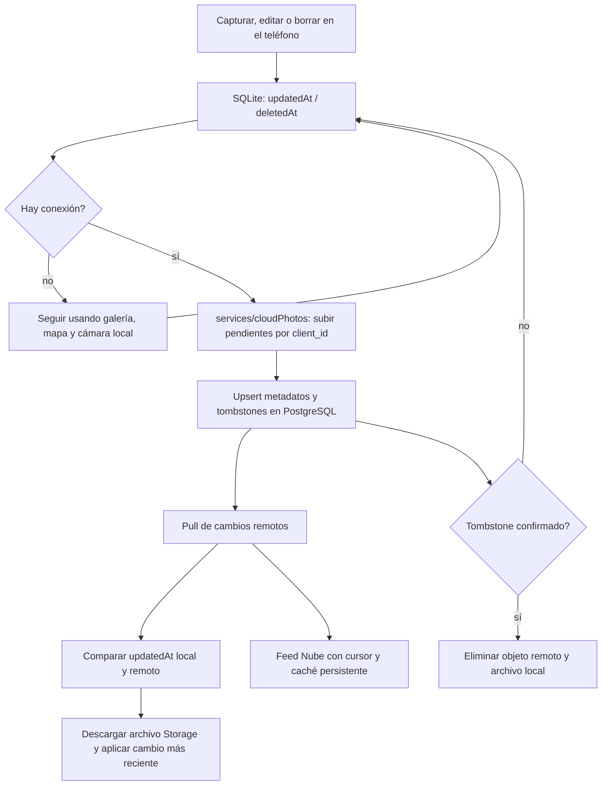
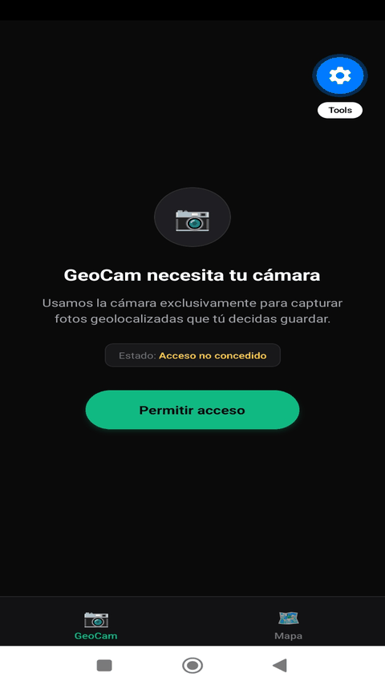

# GeoCam

Aplicación móvil Expo SDK 57 para capturar fotos geolocalizadas, guardarlas en SQLite y sincronizarlas con Supabase para verlas desde otros teléfonos.

## Bases de datos

```mermaid
flowchart LR
  A[Expo / React Native] -->|Drizzle ORM| L[(SQLite local geocam.db)]
  L -->|ownerId + syncedAt vacío| S[Sincronizar uno a uno]
  S -->|ArrayBuffer / Storage API| B[(Supabase Storage privado: geocam)]
  S -->|metadatos + client_id| R[(PostgreSQL: public.photos)]
  R -->|RLS por auth.uid()| A
  B -->|URL firmada temporal| A
  R -. Realtime .-> A
```

SQLite guarda el archivo local y sus metadatos. PostgreSQL guarda metadatos remotos y una ruta única al archivo; Storage conserva los bytes bajo `<auth.uid()>/<client_id>.jpg`. La columna local `owner_id` y todos los repositorios aíslan los datos del usuario activo. La migración `0002_owner_sync.sql` agrega propietario e identidad de sincronización; filas antiguas sin propietario se reclaman a la primera sesión iniciada en ese dispositivo.

### SQL local (Drizzle / SQLite)

Las migraciones completas y ejecutables están versionadas en [`drizzle/`](./drizzle/). El esquema resultante:

```sql
CREATE TABLE albums (
  id TEXT PRIMARY KEY NOT NULL,
  name TEXT NOT NULL,
  created_at INTEGER NOT NULL,
  owner_id TEXT
);
CREATE UNIQUE INDEX albums_owner_name_unique ON albums(owner_id, name);

CREATE TABLE photos (
  id TEXT PRIMARY KEY NOT NULL,
  uri TEXT NOT NULL,
  source TEXT NOT NULL CHECK (source IN ('camera', 'gallery')),
  latitude REAL,
  longitude REAL,
  accuracy REAL,
  coords_timestamp INTEGER,
  created_at INTEGER NOT NULL,
  album_id TEXT REFERENCES albums(id) ON DELETE SET NULL,
  note TEXT,
  favorite INTEGER NOT NULL DEFAULT 0,
  owner_id TEXT,
  client_id TEXT NOT NULL,
  updated_at INTEGER NOT NULL,
  remote_path TEXT,
  synced_at INTEGER
);
CREATE UNIQUE INDEX photos_client_id_unique ON photos(client_id);
```

SQLite no aplica RLS; el aislamiento está en cada consulta de `db/repositories/`, que siempre incluye el ID de sesión. Este SQL PostgreSQL completo también está versionado en [`supabase/schema.sql`](./supabase/schema.sql); aplícalo en el SQL Editor del proyecto Supabase antes de iniciar la app.

### SQL remoto (Supabase PostgreSQL y Storage)

```sql
create table if not exists public.photos (
  id bigint generated always as identity primary key,
  user_id uuid not null default auth.uid() references auth.users(id) on delete cascade,
  client_id text not null unique,
  storage_path text not null unique,
  latitude double precision,
  longitude double precision,
  note text,
  favorite boolean not null default false,
  source text not null check (source in ('camera', 'gallery')),
  taken_at timestamptz not null,
  updated_at timestamptz not null,
  created_at timestamptz not null default now()
);

alter table public.photos enable row level security;
create policy "photos_select_own" on public.photos for select to authenticated using ((select auth.uid()) = user_id);
create policy "photos_insert_own" on public.photos for insert to authenticated with check ((select auth.uid()) = user_id);
create policy "photos_update_own" on public.photos for update to authenticated using ((select auth.uid()) = user_id) with check ((select auth.uid()) = user_id);
create policy "photos_delete_own" on public.photos for delete to authenticated using ((select auth.uid()) = user_id);

insert into storage.buckets (id, name, public) values ('geocam', 'geocam', false)
on conflict (id) do update set public = false;
create policy "geocam_insert_own" on storage.objects for insert to authenticated
with check (bucket_id = 'geocam' and (storage.foldername(name))[1] = (select auth.uid()::text));
create policy "geocam_select_own" on storage.objects for select to authenticated
using (bucket_id = 'geocam' and (storage.foldername(name))[1] = (select auth.uid()::text));
create policy "geocam_update_own" on storage.objects for update to authenticated
using (bucket_id = 'geocam' and (storage.foldername(name))[1] = (select auth.uid()::text))
with check (bucket_id = 'geocam' and (storage.foldername(name))[1] = (select auth.uid()::text));
create policy "geocam_delete_own" on storage.objects for delete to authenticated
using (bucket_id = 'geocam' and (storage.foldername(name))[1] = (select auth.uid()::text));

alter publication supabase_realtime add table public.photos;
```

## Configuración

1. Copia `.env.example` a `.env` y configura `EXPO_PUBLIC_SUPABASE_URL` y `EXPO_PUBLIC_SUPABASE_ANON_KEY` con la URL del proyecto y su publishable/anon key. La app solo contiene credenciales públicas de cliente; nunca pongas una `service_role` key en el cliente. Aplica también la columna `deleted_at` en Supabase; el SQL usa `ADD COLUMN IF NOT EXISTS` para proyectos ya creados.
2. Ejecuta `npm install`. Para Android/iOS, inicia Expo con `npx expo start -c`. Para probar en navegador con SQLite, inicia `npm run web` y abre cualquiera de las URL `GeoCam web` que muestra el terminal. Ambas añaden los encabezados que `SharedArrayBuffer` requiere; no abras el puerto interno de Metro que también muestra el terminal.
3. Supabase Auth debe permitir registro por correo. Si se activa confirmación de correo, confirma el mensaje recibido antes de iniciar sesión.
4. El registro, inicio y cierre de sesión muestran errores en pantalla. Las rutas privadas están protegidas por Expo Router. En Android/iOS Supabase persiste la sesión mediante `expo-secure-store`; no se usa AsyncStorage.

## Sincronización y nube



El servicio sube cada foto por separado; un error deja esa fila pendiente y continúa con las demás. Al regresar la conexión se ejecuta un ciclo automático. `client_id` identifica la misma foto en todos los ciclos, por lo que repetir un upsert no crea otra fila u objeto. El feed ordena por `taken_at` y `client_id` y usa ambos valores como cursor; la búsqueda se limita a la nota y espera 350 ms antes de consultar. TanStack Query persiste páginas por cuenta en AsyncStorage durante siete días.

**Conflictos:** gana el registro con `updatedAt` más reciente; ante igualdad gana el remoto (la comparación usa `>=`). Ejemplo: el teléfono A edita la nota a las 10:05 y queda sin conexión; el teléfono B editó a las 10:03 y ya subió. Cuando A vuelve a conectarse, su hora es posterior y el próximo pull conserva la nota de A. Un `deletedAt` es también una edición, así que un borrado posterior se aplica en los otros teléfonos. El cliente local no borra el archivo hasta confirmar el tombstone en el servidor.

La pestaña **Galería** y el mapa leen SQLite filtrando tombstones. **Nube** muestra fotos remotas, búsqueda y estados de carga, error con reintento, vacío y datos cacheados sin conexión. **Sincronización** informa pendientes, último ciclo, cantidades subidas/bajadas y último error.

### Matriz de pruebas

| Escenario | Resultado esperado | Resultado obtenido en esta sesión |
|---|---|---|
| Crear foto sin conexión y volver a abrir | Foto local visible y pendiente | No ejecutado en dispositivo; cubierto por lectura de SQLite y diseño offline |
| Recuperar red | Pendientes se suben automáticamente | Código del listener verificado; requiere prueba en dispositivo con Supabase configurado |
| Fallo en una subida | Continúan las demás y la fallida queda pendiente | Manejo secuencial por foto inspeccionado; no se inyectó fallo remoto |
| Otra cuenta/dispositivo crea una foto con GPS | Aparece imagen y ubicación local | Pull descarga y guarda el archivo; no ejecutado entre dos dispositivos |
| Repetir ciclo | Sin filas ni objetos duplicados | Upsert por `client_id` y ruta estable revisados; sin prueba remota real |
| Regla de conflicto (local más nuevo, remoto más nuevo, empate y tombstone) | Gana la versión más reciente; remoto en empate | Prueba unitaria Node: 4/4 casos pasaron (`node --test tests/photoConflict.test.mjs`) |
| Propagación integrada de conflicto y borrado a otro teléfono | Gana `updatedAt` más reciente; tombstone se propaga | No ejecutado: requiere dos dispositivos y Supabase configurado |
| Feed: páginas, búsqueda y estados | Cursor, scroll, debounce y cuatro estados | Verificación estática y lint/typecheck; sin sesión Supabase disponible |
| Cierre y apertura sin conexión | Se muestra el último feed cacheado | Persister configurado; no ejecutado en una instalación móvil cerrada |
| Regla pura de conflicto | Local/remoto más reciente; remoto gana el empate | `node --test tests/photoConflict.test.mjs`: 4 pasaron, 0 fallaron |
| Bundle web | Metro completa el empaquetado | Log compartido: `Web Bundled 22583ms ... (1288 modules)`; emitió avisos conocidos de assets CSS de Leaflet y estilos `shadow*` |

No se presenta una prueba integrada como ejecutada: el entorno de esta sesión no tiene un emulador/dispositivo ni credenciales configuradas de Supabase. Para completar la matriz manualmente: instalar build nativo, iniciar sesión en dos teléfonos del mismo usuario, ejecutar cada escenario y reemplazar las celdas pendientes con evidencia observada.

## GIF del flujo



El GIF existente `screenshots/geocam-flow.gif` muestra cámara, filtros, detalle y mapa; no representa todavía una prueba del modo avión. Graba con el dispositivo: abrir Galería, activar modo avión, capturar una foto, mostrar el contador pendiente y volver a conexión. Guarda esa grabación como `screenshots/offline-sync.gif` para documentar el recorrido real.

## Auditoría de credenciales

- `.env` está cubierto por `.gitignore` y no forma parte del índice Git (`git ls-files .env` sin salida).
- Se verificó el historial completo con `git log --all --full-history -- .env`: no devolvió commits.
- `.env.example` existe y contiene valores de ejemplo, no credenciales del proyecto.
- La búsqueda de claves de servicio (`service_role`, `secret key`) en el código de la app no encuentra ninguna. La anon/publishable key es pública y está destinada al cliente; RLS es la barrera de acceso.

## Verificación

```bash
npx expo lint
npx tsc --noEmit
npx expo-doctor
node --test tests/photoConflict.test.mjs
git log --all --full-history -- .env
git ls-files .env
```

La protección de filas y archivos de una segunda cuenta requiere dos usuarios de prueba en el proyecto Supabase y validar las políticas desplegadas con ambos.

Metro completa el bundle web pese a los avisos de rutas `url(images/...)` de `leaflet.css`; el mapa usa marcadores propios. React Native también avisa que algunos estilos `shadow*` de la app están obsoletos y recomienda `boxShadow`; no afectan el feed ni el proceso de sincronización.
